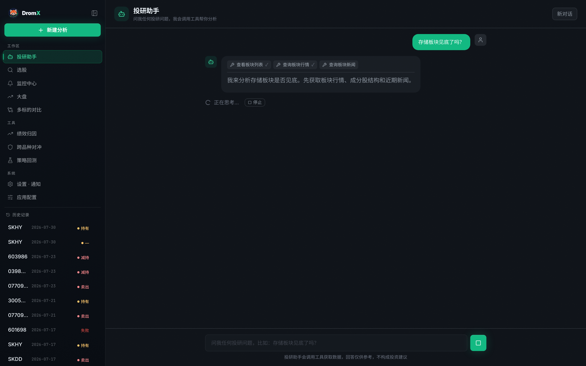
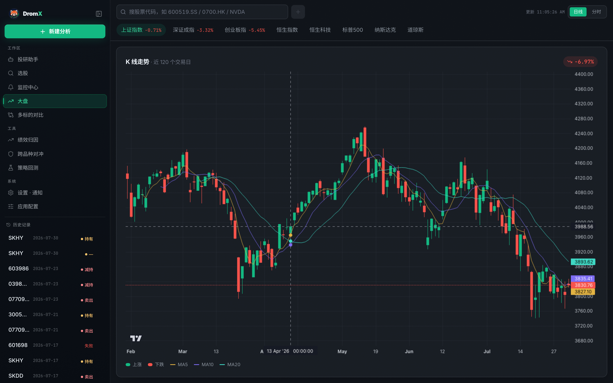

<div align="center">
  
  <h1>DromX Stock</h1>
  <p><strong>你的开源 AI 投研工作台</strong></p>
  <p>聊市场、研究个股、跟踪机会，把零散信息整理成有依据的判断。</p>
  <p>
    <a href="#快速开始">快速开始</a> ·
    <a href="https://github.com/tony3liu/dromx-stock/issues">反馈与建议</a> ·
    <a href="CONTRIBUTING.md">参与贡献</a>
  </p>
  <p>
    
    
  </p>
</div>

## 从一个问题开始

**DromX Stock 是一个可自行部署的 AI 投研助手。** 用自然语言提出问题，结合行情、新闻与基本面展开研究，再继续追问或查看完整报告。

你可以从这些问题开始：

- “最近半导体板块发生了什么？哪些变化值得关注？”
- “帮我研究这只股票，看看机会和主要风险。”
- “这次财报会改变之前的判断吗？”
- “回看我的买卖操作，有哪些地方值得改进？”

适合希望建立日常研究习惯的个人投资者，也适合想搭建自己投研工具的开发者。支持 A 股、港股、美股等市场；不同市场的数据覆盖和可用性取决于所用数据源。

## 你能用它做什么

| 场景 | DromX 提供的帮助 |
| --- | --- |
| 和 AI 聊市场 | 多轮追问，查看研究过程，随时停止任务 |
| 深入研究个股 | 汇总行情、新闻、基本面等信息，整理机会、风险与判断依据 |
| 阅读研究报告 | 查看不同情景、仓位参考和可能推翻结论的条件，导出 PDF |
| 跟踪市场 | 查看 K 线与分时行情，管理自选股 |
| 探索投资机会 | 用自然语言描述选股条件，查看结果并继续调整 |
| 复盘与组合研究 | 探索策略回测、持仓分析、风险评估与组合优化 |

选股、监控、回测和组合工具仍在持续迭代，功能与结果请结合实际数据核对。

## 界面预览

<div align="center">
  
  <p><em>从问题出发，在对话中持续研究。</em></p>
  
  <p><em>把行情和自选放在同一个工作台。</em></p>
</div>

## 自己掌握工具和模型

- **本地部署**：在自己的电脑上运行，保存配置与研究记录。
- **自选模型**：支持 DeepSeek、OpenAI、Anthropic、Gemini、Kimi 等，也可连接 Ollama 或兼容接口。
- **按需配置**：在页面选择模型、填写密钥，无需先修改代码。
- **自由扩展**：源码开放，欢迎增加数据源、改进研究体验或分享新的使用方法。

模型 API 可能产生费用；行情、新闻和联网查询依赖第三方服务及网络。使用外部模型时，相关问题和研究内容会发送给所配置的服务商。

## 快速开始

准备 **Python 3.10+**、**Node.js 22.12+** 和 Git。以下命令适用于 macOS / Linux；Windows 虚拟环境激活命令见[运行说明](webapp/README.md)。

**1. 下载项目并启动后端**

```bash
git clone https://github.com/tony3liu/dromx-stock.git
cd dromx-stock
python3 -m venv .venv
source .venv/bin/activate
python -m pip install -e ".[web]"
python -m uvicorn webapp.backend.main:app --host 127.0.0.1 --port 8077
```

**2. 另开一个终端，启动界面**

```bash
cd dromx-stock/webapp/frontend
npm ci
npm run dev
```

**3. 开始使用**

打开 [http://localhost:5173](http://localhost:5173)，进入「应用配置」，选择模型提供商，填写对应密钥与模型名称并保存。随后到「投研助手」提出第一个问题。

例如使用 DeepSeek 时，可选择 `deepseek`，填写密钥，并将快速模型设为 `deepseek-chat`、深度模型设为 `deepseek-reasoner`。其他提供商请使用其当前可用的模型名称。

更多运行选项与常见问题见[运行说明](webapp/README.md)。终端用户也可以在激活虚拟环境后运行 `python main.py`。

## 一起完善 DromX

欢迎通过 [Issues](https://github.com/tony3liu/dromx-stock/issues) 分享需求、问题与使用体验，也欢迎提交 Pull Request。贡献方式和开发验证命令见 [CONTRIBUTING.md](CONTRIBUTING.md)。

## 许可与致谢

项目采用 [Apache License 2.0](LICENSE)，欢迎使用、修改与分发，请保留许可和相关署名。

感谢 [TradingAgents](https://github.com/TauricResearch/TradingAgents) 提供的基础工作，以及开源社区的模型接入、行情数据与图表工具。

**投资提示**：DromX 用于信息整理与研究辅助，不构成投资建议。AI 输出和第三方数据可能存在错误、延迟或缺失，投资决策与风险由使用者自行判断和承担。
